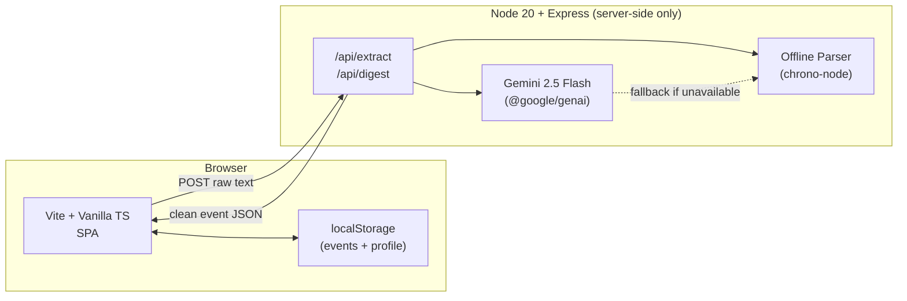

# Campus Pulse 🎓

> **Intelligent Campus Life Organiser** — built for the [Google Prompt Wars Hackathon](https://hack2skill.com) (Hack2skill × Google for Developers × CSSS).

Paste messy WhatsApp messages, emails, or poster text → AI extracts a clean event card (title, date, time, venue, category) → the app organises, prioritises, and summarises your campus life.

---

## Features

| Feature | Status |
|---------|--------|
| AI event extraction (Gemini 2.5 Flash) | ✅ |
| Offline fallback (rule-based parser + Hinglish support) | ✅ |
| Schedule clash detection | ✅ |
| "Needs Attention Today" banner | ✅ |
| Weekly AI digest (copy to clipboard) | ✅ |
| Smart filtering & search | ✅ |
| Calendar grid view | ✅ |
| Profile personalisation (dept / year / relevant-to-me) | ✅ |
| Voice input (en-IN / hi-IN) | ✅ |
| Browser push notification reminders | ✅ |
| WCAG 2.2 AA accessibility | ✅ |
| Light / dark theme + text-size switcher | ✅ |

---

## Architecture



### Key Design Decisions

- **No client-side AI** — Gemini API key never leaves the server. The browser only sees cleaned JSON.
- **Zero innerHTML** — All DOM construction uses safe helpers (`el()`, `text()`). ESLint enforces this.
- **Offline-first fallback** — If Gemini is down, `offlineParser.ts` (chrono-node + regex) handles extraction.
- **Local-only storage** — No PII on the server. Events and preferences stay in `localStorage`.

---

## Getting Started

### Prerequisites

- Node.js ≥ 20.18
- A Gemini API key (free tier works; [get one here](https://aistudio.google.com/app/apikey))

### Installation

```bash
git clone https://github.com/your-username/campus-pulse.git
cd campus-pulse
npm install
```

### Environment Variables

Copy `.env.example` and fill in your key:

```bash
cp .env.example .env
```

| Variable | Required | Description |
|----------|----------|-------------|
| `GEMINI_API_KEY` | Yes | Your Google AI Studio API key |
| `PORT` | No | Server port (default: `3000`) |
| `NODE_ENV` | No | `development` or `production` |

> **Never commit `.env`** — it's in `.gitignore`.

### Development

```bash
# Terminal 1: Start the backend (watches for changes)
npm run dev:server

# Terminal 2: Start the Vite dev server (HMR)
npm run dev:client
```

Then open [http://localhost:5173](http://localhost:5173). The Vite dev server proxies `/api/*` to port 3000.

### Production Build

```bash
npm run build       # builds client bundle + server bundle
npm start           # serves everything on PORT (default 3000)
```

---

## Security

See [SECURITY.md](./SECURITY.md) for the full threat model. Summary:

- API key is **server-side only**, validated at startup via Zod, never logged.
- Prompt injection defences: user text wrapped in `<<<USER_UNTRUSTED_CONTENT>>>` delimiters; AI output re-validated by Zod.
- Strict **Content Security Policy** via `helmet` (no unsafe-eval, no inline scripts).
- **Rate limiting**: 20 requests/min per IP on `/api/*`.
- **20 KB request body limit** on Express.
- **Zero `innerHTML`** — ESLint bans it project-wide.

---

## Accessibility

Campus Pulse targets **WCAG 2.2 AA**:

- Semantic landmark regions (`<header>`, `<main>`, `<footer>`, `<section>`)
- Single `<h1>`, logical heading hierarchy
- Skip-navigation link as first focusable element
- All interactive elements ≥ 44×44 px touch target
- Focus ring visible in both themes (3px offset)
- `aria-live="polite"` announcer for dynamic content
- Modal dialogs: focus trap, Esc to close, `aria-modal="true"`, `aria-labelledby`
- Calendar grid: `role="grid"`, `role="columnheader"`, `role="gridcell"`, keyboard nav
- Color is never the sole differentiator (badges use icon + color + text)
- Light and dark themes both tested with axe-core (zero violations)
- `prefers-reduced-motion` respected

Run the accessibility suite:

```bash
npm run build && npm run e2e -- --grep="Accessibility"
```

---

## Testing

```bash
# Unit + API tests (no browser needed)
npm test

# E2E + Accessibility tests (requires built dist/)
npm run build
npm run e2e

# Individual suites
npx playwright test tests/e2e/flow.spec.ts
npx playwright test tests/e2e/a11y.spec.ts
npx playwright test tests/e2e/clash.spec.ts
```

### Test Coverage

| Suite | File | Tests |
|-------|------|-------|
| Unit: Status logic | `tests/unit/status.test.ts` | 9 |
| Unit: Clash detection | `tests/unit/clashes.test.ts` | 6 |
| Unit: Filters & sort | `tests/unit/filters.test.ts` | 5 |
| Unit: Storage & migration | `tests/unit/storage.test.ts` | 7 |
| Unit: Offline parser | `tests/unit/offlineParser.test.ts` | 5 |
| API: Extraction endpoint | `tests/api/extract.test.ts` | 7 |
| API: Security headers | `tests/api/security.test.ts` | 4 |
| E2E: Core flow | `tests/e2e/flow.spec.ts` | 6 |
| E2E: Clash badges | `tests/e2e/clash.spec.ts` | 2 |
| E2E: Accessibility (axe) | `tests/e2e/a11y.spec.ts` | 5 |

---

## Deployment — Google Cloud Run

### Build and Push Docker Image

```bash
# Build
docker build -t campus-pulse .

# Tag for Artifact Registry
docker tag campus-pulse gcr.io/YOUR_PROJECT/campus-pulse

# Push
docker push gcr.io/YOUR_PROJECT/campus-pulse
```

### Deploy to Cloud Run

```bash
gcloud run deploy campus-pulse \
  --image gcr.io/YOUR_PROJECT/campus-pulse \
  --platform managed \
  --region us-central1 \
  --allow-unauthenticated \
  --set-env-vars GEMINI_API_KEY=your_key_here \
  --port 3000
```

> **Production tip:** Store `GEMINI_API_KEY` in [Secret Manager](https://cloud.google.com/secret-manager) and reference it with `--set-secrets GEMINI_API_KEY=campus-pulse-gemini-key:latest`.

---

## Project Structure

```
campus-pulse/
├── src/
│   ├── client/               # Browser code (Vite + TS)
│   │   ├── components/       # UI components (safe DOM only)
│   │   ├── logic/            # Status, clash, filter, notification logic
│   │   ├── storage/          # localStorage service with versioning
│   │   ├── styles/           # CSS (theme, base, components)
│   │   ├── utils/            # Safe DOM helpers (el, text, createSvg)
│   │   ├── index.html        # Entry HTML (semantic, WCAG)
│   │   └── main.ts           # App bootstrap
│   ├── server/               # Node.js server code (never bundled to client)
│   │   ├── middleware/        # helmet CSP, rate-limit, error handler
│   │   ├── routes/           # /api/extract, /api/digest, /health
│   │   ├── schemas/          # Zod validation schemas
│   │   ├── services/         # gemini.ts + offlineParser.ts
│   │   ├── app.ts            # Express app setup
│   │   ├── config.ts         # Env var validation (Zod)
│   │   └── index.ts          # Server entry + graceful shutdown
│   └── shared/               # Types and constants shared by both sides
│       ├── types.ts
│       └── constants.ts
├── tests/
│   ├── unit/                 # Vitest unit tests
│   ├── api/                  # Vitest + supertest API tests
│   └── e2e/                  # Playwright E2E + axe a11y tests
├── scripts/
│   └── size-check.mjs        # Repo size guard (< 5 MB)
├── .env.example              # Template (no real values)
├── .gitignore
├── Dockerfile
├── LICENSE
├── README.md
├── SECURITY.md
├── playwright.config.ts
├── vite.config.ts
├── vitest.config.ts
├── tsconfig.json
└── package.json
```

---

## Scripts Reference

| Script | Description |
|--------|-------------|
| `npm run dev` | Start Vite dev server |
| `npm run dev:server` | Start Express server with watch |
| `npm run build` | Build client + server for production |
| `npm start` | Run production server |
| `npm test` | Unit + API tests (Vitest) |
| `npm run e2e` | E2E + accessibility tests (Playwright) |
| `npm run lint` | ESLint check |
| `npm run typecheck` | TypeScript type check |
| `npm run size-check` | Verify repo < 5 MB |

---

## Hackathon Context

**Event:** Prompt Wars — Hack2skill × Google for Developers × CSSS  
**Challenge:** Build an AI-powered campus event organiser using Google Gemini.  
**Judging criteria (in order):** Security → Accessibility → Code Quality → Testing → Problem Alignment → Efficiency

---

*Made with ❤️ for campus students everywhere.*

